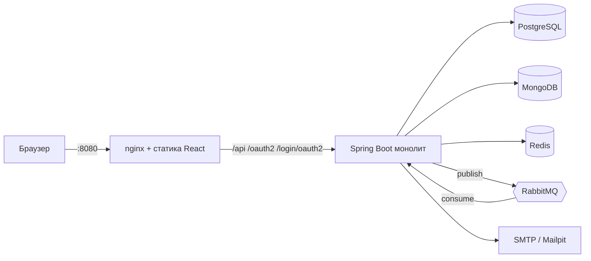

# INSTRUCTION.md — архитектура и правила разработки

Документ для разработчиков и ИИ-агентов. **Прочитай целиком перед любым изменением.**
Если решение меняется, обнови этот файл в том же PR.

## 1. Продукт

**ООО «Тмыв денег»** — внешнее название сервиса. Репозиторий: `Ratila1/mortgage-planner`.
Код живёт в пакете `dev.nosurprise` (историческое имя; переименование — отдельная задача, не делать попутно).

Люди берут ипотеку на 25 лет и не понимают, сколько переплатят и что будет при росте ставки.
Сервис честно и быстро показывает: платёж, переплату, полный график, эффект досрочных погашений.

Принципы:
1. **Честность цифр.** Деньги только `BigDecimal`, округление всегда явное. Результат сверяется с банковским калькулятором.
2. **Скорость.** Расчёт на 30 лет — миллисекунды, без обращений к БД внутри расчётного ядра.
3. **Простота.** Модульный монолит, никаких микросервисов.

## 2. Стек

| Что | Версия / выбор |
|---|---|
| Язык | Java 25, виртуальные потоки (`spring.threads.virtual.enabled=true`) |
| Фреймворк | Spring Boot 4.0.9 (Spring Framework 7, Jackson 3), Gradle Groovy DSL |
| Безопасность | Spring Security, JWT (Nimbus через resource-server), OAuth2 client (Google/GitHub) |
| Данные | PostgreSQL (+Flyway), MongoDB, Redis |
| Очередь | RabbitMQ (Spring AMQP) |
| Почта | JavaMailSender; локально Mailpit |
| Фронт | React 19 + Vite + TypeScript, тесты vitest |
| Инфра | Docker Compose, nginx как единая точка входа, Cloudflare Tunnel (опционально) |
| CI | GitHub Actions: Backend, Frontend, Docker build, Branch policy |

## 3. Архитектура



**Один хост.** Фронт и бэк доступны по одному адресу (`http://localhost:8080` или туннель Cloudflare).
Бэкенд наружу порт не публикует, весь трафик идёт через nginx. Поэтому нет CORS, а refresh-токен лежит
в httpOnly-cookie. Любой новый публичный путь бэкенда нужно добавить в `frontend/nginx.conf` и в proxy `vite.config.ts`.

**Модульный монолит.** Модули — пакеты внутри одного приложения. Consumer-ы RabbitMQ живут в этом же приложении.

## 4. Структура

```
backend/src/main/java/dev/nosurprise/
  calculator/     чистое расчётное ядро (без Spring, БД и IO)
  common/         Money, ошибки (ProblemDetail), Clock, утилиты
  calc/           расчёт: web (controller, dto) → service → repository (Mongo); POST/GET /api/calc
  config/         SecurityConfig, Redis/Mongo/Rabbit конфигурации
  auth/           регистрация, логин, JWT, refresh, OAuth2, подтверждение почты
  user/           пользователи и роли
  offer/          банковские предложения + кэш + событие смены ставки
  scenario/       сохранённые сценарии, сравнение, пересчёт
  notification/   уведомления (в БД + письма), consumer-ы очереди
backend/src/main/resources/db/migration/   Flyway: V{N}__описание.sql
frontend/src/                              React-приложение
```

Правила зависимостей (нарушать нельзя):
- `calculator` не зависит ни от чего, кроме `common.Money`. Никаких аннотаций Spring.
- Слои внутри модуля: `web (controller, dto)` → `service` → `repository`. Контроллер не ходит в репозиторий.
- JPA-сущности и Mongo-документы не возвращаются из контроллеров, только DTO (`record`).
- Модули общаются через публичные сервисы или события RabbitMQ, но не через чужие репозитории.
- Допустимые зависимости: `scenario → calculator, offer`; `calc → calculator`; `auth → user`; `notification` слушает события; `offer` ни от кого.

## 5. Расчётное ядро (`calculator`)

### Входные данные
`price`, `downPayment`, `termMonths` (1..360), `annualRate` (проценты годовых, 0..100),
`type` = `ANNUITY | DIFFERENTIATED`, список досрочных погашений.
`loanAmount = price − downPayment` (должно быть > 0, `downPayment ≥ 0`, `downPayment < price`).

### Формулы
- Месячная ставка `r = annualRate / 100 / 12`.
- **Аннуитет:** `payment = S·r / (1 − (1+r)^(−n))`; при `r = 0` → `S / n`.
- **Дифференцированный:** основной долг в месяц `S / n`, проценты `остаток · r`, платёж = долг + проценты.
- Проценты каждого месяца округляются до копеек (`HALF_UP`) и входят в график уже округлёнными.
- Последний платёж корректируется так, чтобы остаток стал ровно `0.00`.
- Промежуточные вычисления идут в `Money.MC`, наружу отдаётся `Money.round` (scale 2, `HALF_UP`).
- **Переплата = сумма начисленных процентов** (не «сумма платежей минус цена жилья»).

### Досрочные погашения
- Разовое: `{type: ONE_TIME, month, amount}`.
- Регулярное: `{type: REGULAR, startMonth, everyMonths, amount, untilMonth?}`.
- Режим (на каждое погашение): `REDUCE_TERM` (платёж остаётся, срок сокращается) или `REDUCE_PAYMENT` (срок остаётся, платёж пересчитывается).
- Погашение применяется **после** очередного планового платежа того же месяца. Сумма ограничивается текущим остатком.
- Аннуитет + `REDUCE_PAYMENT`: платёж пересчитывается на оставшийся срок. Дифференцированный + `REDUCE_PAYMENT`: пересчитывается основной долг `остаток / оставшиеся_месяцы`.
- Результат считает «сэкономили»: сравнение с расчётом без досрочных (на сколько меньше переплата и месяцев).

### Строка графика
`month, date?, payment, principal, interest, earlyRepayment, balance`. Все суммы в JSON — **строки** (`"88848.79"`), чтобы не терять точность на фронте.

### Эталоны для тестов
Кредит 1 000 000, 12 % годовых, 12 месяцев:
- аннуитет: платёж `88848.79`;
- дифференцированный: первый платёж `93333.33` (83333.33 долг + 10000.00 проценты).
  Остальные эталоны сверять с любым банковским калькулятором с допуском ±0.01 на платёж. Обязательно покрыть: ставка 0, срок 1 месяц, погашение больше остатка, регулярные погашения до конца срока, оба режима для обоих типов.

## 6. Данные

### 6.1 PostgreSQL (Flyway, `ddl-auto: validate`)
Миграции только вперёд, применённые миграции не править. Имя: `V{N}__snake_case.sql`.

| Таблица | Ключевые поля |
|---|---|
| `users` | id, email (unique), password_hash (null для OAuth), email_verified, provider (`LOCAL/GOOGLE/GITHUB`), provider_id, created_at |
| `user_roles` | user_id, role (`USER`, `ADMIN`) |
| `bank_offers` | id, bank_name, rate numeric(5,2), min_down_payment_percent numeric(5,2), max_term_months, active, updated_at, version |
| `saved_scenarios` | id, user_id, name, params jsonb, summary jsonb, calc_id (Mongo ObjectId), offer_id (nullable, FK), created_at, updated_at |
| `notifications` | id, user_id, type, payload jsonb, read, created_at |

Демо-данные банков (вымышленные) кладутся в отдельную миграцию `V{N}__seed_offers.sql`.
Первый ADMIN создаётся при старте из `APP_ADMIN_EMAIL` / `APP_ADMIN_PASSWORD` (пароли в миграциях не хранить).

### 6.2 MongoDB
Коллекция `calculations`: один документ на расчёт.
```
_id, paramsHash, userId?, params{...}, summary{monthlyPayment, overpayment, totalPaid, termMonths, saved?},
schedule[{month, payment, principal, interest, earlyRepayment, balance}], createdAt, expireAt?
```
- Индексы: `paramsHash`; `(userId, createdAt desc)` — это и есть «история расчётов».
- Анонимные расчёты получают `expireAt = now + 7 дней` (TTL-индекс), расчёты пользователя живут бессрочно.
- Деньги хранить как `Decimal128`: `spring.data.mongodb.representation.big-decimal=decimal128` (по умолчанию BigDecimal уходит строкой).

### 6.3 Redis
| Ключ | Значение | TTL |
|---|---|---|
| `calc:{sha256(params)}` | calcId | 1 ч |
| `offers:all` | список активных предложений (JSON) | 5 мин, сбрасывается при изменении предложения |
| `refresh:{userId}:{sha256(token)}` | метаданные refresh-токена | 30 дн |
| `ratelimit:calc:{ip или userId}` | счётчик окна | 60 с |
| `verify:{token}` | userId для подтверждения почты | 24 ч |
| `otp:{email}` | хэш кода (звёздочка) | 10 мин |

Хэш параметров считается от канонического вида: `BigDecimal` в `stripTrailingZeros().toPlainString()`, досрочные погашения в отсортированном порядке.
Rate limit по умолчанию: аноним 30 запросов/мин на IP, пользователь 120/мин, ответ `429` + `Retry-After`. Лимиты вынести в `application.yml`.

## 7. Безопасность

- `/api/calc/**`, `/api/offers`, `/api/auth/**`, `/actuator/health/**` — публичные. `/api/admin/**` — `ROLE_ADMIN`. Остальное — аутентифицированные.
- Пароли: `DelegatingPasswordEncoder` (bcrypt). Вход до подтверждения почты → `403` с кодом `EMAIL_NOT_VERIFIED`.
- **JWT access:** подписанный (HS256, секрет `JWT_SECRET`), TTL 15 мин, в заголовке `Authorization: Bearer`. На фронте — только в памяти, не в localStorage.
- **Refresh:** случайный opaque-токен (не JWT), в Redis хранится только его SHA-256. Доставка — httpOnly, `Secure` (при https), `SameSite=Lax`, `Path=/api/auth` cookie. Ротация при каждом `/refresh` (старый удаляется). `logout` удаляет токен; «выйти везде» удаляет `refresh:{userId}:*`.
- **OAuth2:** Google и GitHub, включается профилем `oauth` (`SPRING_PROFILES_ACTIVE=oauth`) и секретами из `.env`. После успешного входа успешный handler находит или создаёт пользователя (связь по email, `email_verified=true` от провайдера) и выдаёт ту же пару токенов. Redirect URI: `{APP_BASE_URL}/login/oauth2/code/{google|github}`.
- Секреты только через переменные окружения. В репозиторий не коммитить `.env`, ключи, токены.
- Cloudflare/nginx ставят `X-Forwarded-*`; Spring настроен `forward-headers-strategy: framework`. IP клиента для rate limit брать из заголовка, который выставляет доверенный прокси.

## 8. RabbitMQ

Один topic-exchange `domain.events`; все сообщения — JSON-`record` с `eventId` (UUID) и `occurredAt`.

| Routing key | Когда публикуется | Consumer (очередь) |
|---|---|---|
| `offer.rate.changed` | админ изменил ставку предложения | `scenario.recalc.q` → пересчёт затронутых сценариев |
| `scenario.recalculated` | сценарий пересчитан | `notification.q` → запись в `notifications` + письмо |
| `mail.requested` | нужно отправить письмо (подтверждение почты, уведомление) | `mail.send.q` → JavaMailSender |
| `export.pdf.requested` (★) | запрос PDF графика | `export.pdf.q` |

Правила:
- Публиковать **после коммита** транзакции (`@TransactionalEventListener(AFTER_COMMIT)`), иначе consumer увидит старые данные.
- Consumer-ы **идемпотентны** (повторная доставка того же `eventId` не создаёт дубль уведомления).
- Каждая очередь имеет DLQ: `x-dead-letter-exchange = domain.events.dlx`, очередь `<имя>.dlq`. Ретраи: 3 попытки с экспоненциальной паузой (1с, 2с, 4с) через `spring.rabbitmq.listener.simple.retry`, затем сообщение уходит в DLQ.
- **Затронутые сценарии** = `saved_scenarios.offer_id = offerId` события. Пересчёт идёт с новой ставкой, в уведомлении показываем «было → стало» (платёж и переплата).

## 9. HTTP API (контракт, первая версия)

Ошибки — RFC 7807 (`ProblemDetail`) с полем `code`. Время — UTC, `Instant`. Деньги — строки.

```
POST /api/calc                        публично, rate limit
     тело: {price, downPayment, termMonths, annualRate, type, earlyRepayments[]}
     ответ: {calcId, loanAmount, monthlyPayment, overpayment, totalPaid, termMonths, savings?, schedule[]}
GET  /api/calc/{calcId}               график расчёта (из Mongo)
POST /api/calc/stress          (★)    «что если ставка вырастет на N п.п.» — [{delta, monthlyPayment, overpayment}]

POST /api/auth/register               email + пароль → письмо с подтверждением
GET  /api/auth/verify-email?token=    подтверждение
POST /api/auth/login                  → access в теле, refresh в cookie
POST /api/auth/refresh                ротация refresh
POST /api/auth/logout                 отзыв refresh
GET  /oauth2/authorization/{google|github}
POST /api/auth/otp/request, /verify   (★) вход по одноразовому коду
GET  /api/me

GET    /api/scenarios                 свои сценарии
POST   /api/scenarios                 {name, params, offerId?} — считает и сохраняет
DELETE /api/scenarios/{id}
GET    /api/scenarios/compare?ids=1,2,3   2–3 сценария рядом (проверка владельца)
GET    /api/notifications, POST /api/notifications/{id}/read

GET    /api/offers                    публично, из кэша
POST/PUT/DELETE /api/admin/offers[/{id}]   ADMIN; PUT со сменой ставки → событие
POST   /api/scenarios/{id}/export/pdf (★) → 202 +