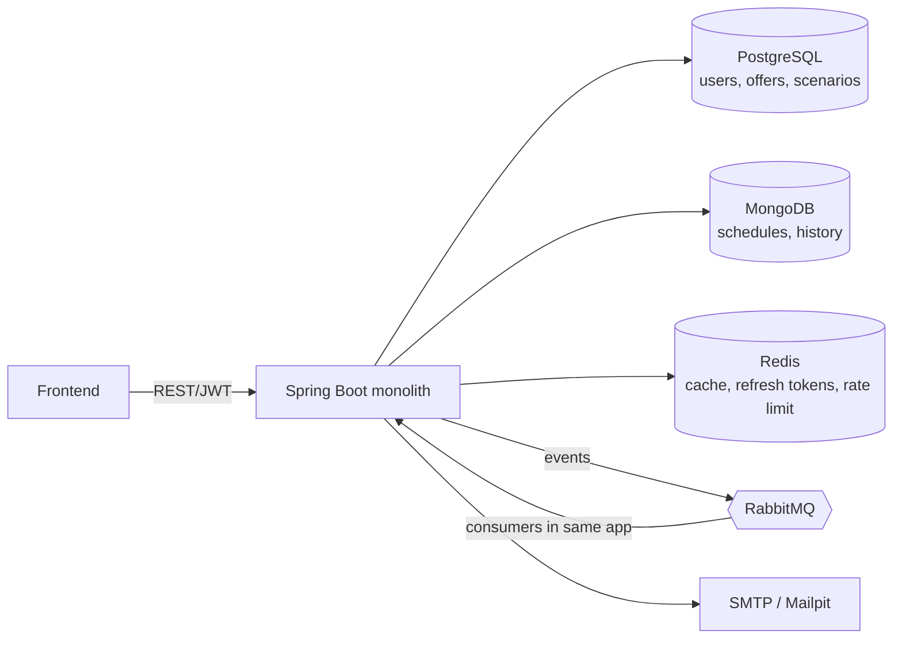

# NoSurprise — «Ипотека без сюрпризов»

Сервис честно показывает, сколько на самом деле стоит ипотека на 25 лет и что будет, если ставка вырастет.

## Быстрый старт

```bash
cp .env.example .env      # опционально, есть дефолты
docker compose up --build
# публичная ссылка через Cloudflare quick tunnel:
docker compose --profile tunnel up --build
```

| Сервис            | URL                     |
|-------------------|-------------------------|
| Фронтенд + API    | http://localhost:8080 (nginx проксирует /api) |
| RabbitMQ UI       | http://localhost:15672  |
| Mailpit (письма)  | http://localhost:8025   |

### Локальная разработка
```bash
docker compose up -d postgres mongo redis rabbitmq mailpit
cd backend && gradle bootRun          # или ./gradlew bootRun после `gradle wrapper`
cd frontend && npm install && npm run dev
```
Нужны: JDK 25, Node 22, Docker.

## Структура
```
backend/    Spring Boot 4 (Java 25, Gradle Groovy) — модульный монолит
frontend/   React + Vite + TS (отдаётся через nginx, /api проксируется в backend)
docs/       заметки и ADR
.github/    CI, CODEOWNERS, шаблон PR
```

## Архитектура


Пакеты backend (`dev.nosurprise.*`): `calculator`, `auth`, `user`, `offer`, `scenario`, `notification`, `common`, `config`.
Зависимости только «вниз»: `calculator` — чистое ядро без Spring и БД.

## Принятые решения
- **Модульный монолит, а не микросервисы.** Один деплой, одна команда, транзакции без распределённой боли. Очередь используется для асинхронности, а не для разрезания сервиса. Границы модулей держим пакетами; при необходимости consumer-ы можно вынести в отдельный профиль/процесс.
- **Java 25 + виртуальные потоки** (`spring.threads.virtual.enabled=true`): блокирующий код для JPA/Mongo/Redis без реактивщины.
- **Деньги — только `BigDecimal`**, политика в `common/Money` (scale 2, HALF_UP; промежуточные расчёты в повышенной точности).
- **Flyway** для PostgreSQL, схема валидируется (`ddl-auto: validate`).
- **Testcontainers** для интеграционных тестов (auth-флоу, сценарий с очередью).

## Git-процесс
- `main` — стабильная, в неё только PR из `dev`.
- `dev` — интеграционная ветка; личные ветки (`ratnikau/...`, `radkovski/...`) → PR в `dev`.
- Прямой push в `main`/`dev` запрещён. Обязательные проверки: **Backend**, **Frontend**, **Docker build** (+ **Branch policy** для `main`), минимум 1 approve, squash merge.
