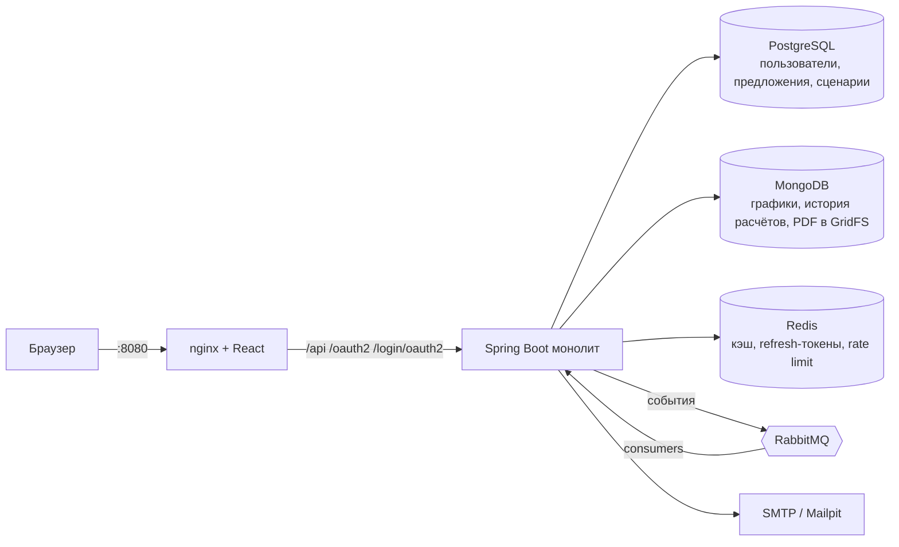

<div align="center">


# ООО «Тмыв денег» — ипотека без сюрпризов

**Честная цена ипотеки на 25 лет — за один экран, без логина и мелкого шрифта.**

Ежемесячный платёж · реальная переплата · полный график · досрочные погашения · стресс-тест ставки

[](https://github.com/Ratila1/mortgage-planner/actions/workflows/ci.yml)


</div>

---

Люди берут ипотеку на 25 лет и не понимают, сколько переплатят и что будет, если ставка вырастет.
Сервис быстро и честно показывает цифры: расчёт на `BigDecimal`, график с точностью до копейки,
тест «а если ставка +3 п.п.?». Никаких микросервисов — один модульный монолит, который просто работает.

## ✨ Возможности

| | Фича | Что умеет |
|---|---|---|
| 🧮 | **Калькулятор без логина** | Аннуитетный и дифференцированный платёж, график (таблица + диаграмма), разовые и регулярные досрочные погашения (уменьшить срок / платёж), «сколько сэкономите» |
| 📈 | **Стресс-тест** | Что будет с платежом и переплатой, если ставка вырастет на 1–5 п.п. |
| 👤 | **Аккаунты** | Email + пароль с подтверждением почты, вход по одноразовому коду (OTP), вход через Google/GitHub, JWT (access + refresh в httpOnly-cookie) |
| 🗂 | **Личный кабинет** | Сохранение сценариев, сравнение 2–3 сценариев бок о бок, история расчётов, уведомления |
| 📄 | **PDF-график** | Экспорт графика сценария в PDF — генерация через очередь, файл хранится в GridFS |
| 🛠 | **Админка** | CRUD банковских предложений; смена ставки запускает пересчёт затронутых сценариев и уведомление пользователей («было → стало») через RabbitMQ |

## 🖥 Экраны

| Путь | Что там |
|---|---|
| `/` | калькулятор (без входа) |
| `/login`, `/register`, `/verify-email` | вход, регистрация, подтверждение почты |
| `/scenarios` | сохранённые сценарии + экспорт PDF |
| `/compare` | сравнение 2–3 сценариев |
| `/notifications` | уведомления |
| `/admin/offers` | админка банковских предложений |

## 🚀 Быстрый старт

> Нужны Docker и Docker Compose. Всё поднимается одной командой.

```bash
cp .env.example .env
docker compose up --build
```

| Что | Адрес |
|---|---|
| 💚 Приложение (фронт + API) | [http://localhost:8080](http://localhost:8080) |
| 🐰 RabbitMQ UI | [http://localhost:15672](http://localhost:15672) — `guest` / `guest` |
| 📬 Письма (Mailpit) | [http://localhost:8025](http://localhost:8025) |

<details>
<summary><b>🔑 Демо-доступ и детали запуска</b></summary>

- `.env` необязателен: у всех переменных в `docker-compose.yml` есть значения по умолчанию.
- Старт упорядочен healthcheck-ами: nginx открывает порт только когда Spring Boot полностью поднялся.
- **Демо-админ** создаётся при старте: `admin@nosurprise.local` / `admin12345`
  (меняется через `APP_ADMIN_EMAIL` / `APP_ADMIN_PASSWORD`).
- Обычный пользователь — регистрация на сайте; письмо с подтверждением приходит в Mailpit.
- Чистый старт с пустыми базами: `docker compose down -v`.
- Кнопки «Войти через Google / GitHub» появляются сами, когда бэкенд запущен с профилем `oauth`:
  фронт спрашивает список провайдеров у `GET /api/auth/oauth/providers`.

</details>

<details>
<summary><b>🌍 Публичная ссылка через Cloudflare Tunnel</b></summary>

```bash
docker compose --profile tunnel up --build
docker compose logs cloudflared     # найди https://<...>.trycloudflare.com
```

Вход через Google/GitHub работает только на `localhost:8080` или на именованном туннеле:
redirect URI нужно регистрировать заранее.

</details>

### 🔧 Локальная разработка

```bash
docker compose up -d postgres mongo redis rabbitmq mailpit
cd backend  && gradle bootRun                 # JDK 25
cd frontend && npm install && npm run dev     # Node 22 → http://localhost:5173
```

### 🧪 Тесты

```bash
cd backend  && gradle build           # юнит + Testcontainers (нужен Docker)
cd frontend && npm test && npm run build
```

<details>
<summary><b>🔐 OAuth: вход через Google и GitHub (необязательно)</b></summary>

1. **Google:** [console.cloud.google.com](https://console.cloud.google.com) → APIs & Services → Credentials →
   Create credentials → OAuth client ID → Web application.
   Authorized redirect URI: `http://localhost:8080/login/oauth2/code/google`.
2. **GitHub:** Settings → Developer settings → OAuth Apps → New OAuth App.
   Homepage URL: `http://localhost:8080`, Authorization callback URL: `http://localhost:8080/login/oauth2/code/github`.
3. В `.env`: `GOOGLE_CLIENT_ID/SECRET`, `GITHUB_CLIENT_ID/SECRET`, `SPRING_PROFILES_ACTIVE=oauth`.
   Нужны ключи **обоих** провайдеров, иначе бэкенд не стартует.
4. `docker compose up --build` и открыть именно `http://localhost:8080` (не `:5173`).

Для другого адреса (туннель, домен) поменяй `APP_BASE_URL` и redirect URI в обеих консолях.

**Как это работает:** кнопка ведёт на `/oauth2/authorization/{google|github}`, после входа бэкенд ставит
refresh-cookie и возвращает на `/`, фронт сам получает access-токен. Если GitHub скрывает почту,
бэкенд берёт основной подтверждённый адрес из `/user/emails`. Ошибки возвращают на `/login?oauthError=…`.

</details>

## 🏗 Архитектура



**Один хост.** Фронт и бэк доступны по одному адресу, бэкенд наружу порт не публикует — весь трафик
идёт через nginx. Поэтому нет CORS, а refresh-токен лежит в httpOnly-cookie.
**Модульный монолит:** consumer-ы RabbitMQ живут в том же приложении, никаких микросервисов.

> 📚 Подробно (модули, схемы данных, ключи Redis, топология RabbitMQ, API-контракт):
> **[INSTRUCTION.md](INSTRUCTION.md)** · журнал прогресса и решений — **[HANDOFF.md](HANDOFF.md)**

## 🧱 Стек

| Слой | Технологии |
|---|---|
| Бэкенд | Java 25 (виртуальные потоки), Spring Boot 4.0.9, Spring Security (JWT + OAuth2 client), OpenPDF |
| Данные | PostgreSQL + Flyway, MongoDB + GridFS, Redis |
| Очереди | RabbitMQ (события: пересчёт сценариев, письма, PDF) |
| Фронтенд | React 19, Vite, TypeScript, Tailwind CSS 4, React Router 7, Recharts |
| Инфраструктура | Docker Compose, nginx как единая точка входа, Cloudflare Tunnel (опционально) |
| CI | GitHub Actions: backend + Testcontainers, frontend, Docker build, branch policy |

## 📁 Структура

```
backend/          Spring Boot, модульный монолит
  calculator/       чистое расчётное ядро (без Spring и БД)
  calc/             расчёт + кэш + rate limit
  auth/             регистрация, JWT, refresh, OAuth2, OTP
  user/             пользователи и роли
  offer/            банковские предложения + кэш
  scenario/         сохранённые сценарии, сравнение, пересчёт
  notification/     уведомления + consumer-ы очередей
  pdf/              генерация PDF-графика
frontend/         React + Vite + Tailwind, отдаётся через nginx
INSTRUCTION.md    архитектура и правила для разработчиков и агентов
HANDOFF.md        журнал прогресса и принятых решений
.github/          CI, CODEOWNERS, шаблон PR, лого для README
```

## 🤝 Разработка

- Ветка `dev` — основная рабочая, фичи идут через `feature/*` → `dev`.
- PR в `main` принимаются **только из `dev`** (проверяет CI job `branch-policy`).
- На каждый PR гоняются: backend (юнит + Testcontainers), frontend (vitest + сборка), сборка Docker-образов.

---

<div align="center">

Сделано с 💚 командой «Тмыв денег» · [Ratila1/mortgage-planner](https://github.com/Ratila1/mortgage-planner)

</div>
