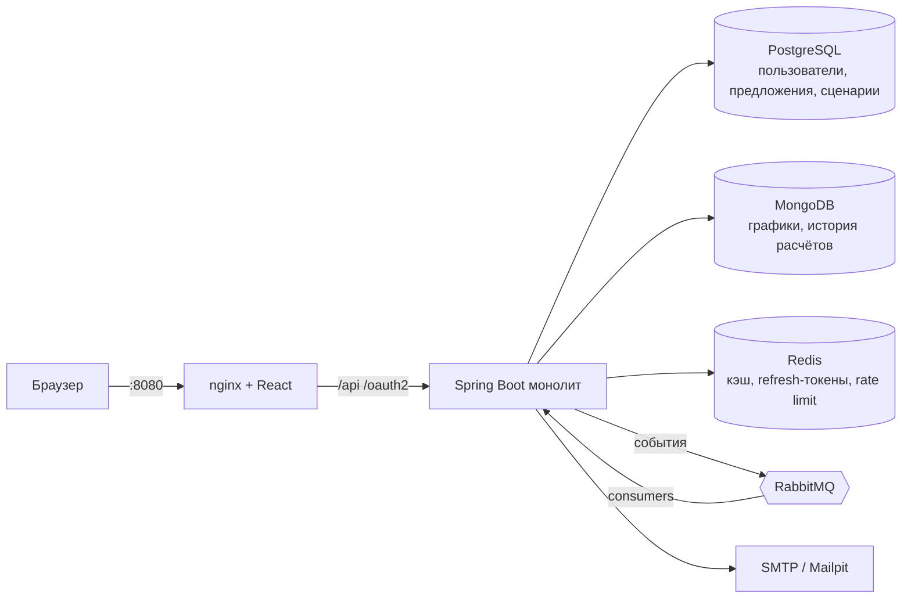

# ООО «Тмыв денег» — ипотека без сюрпризов

Сервис показывает честную цену ипотеки на 25 лет: ежемесячный платёж, реальную переплату, полный график
и что будет при досрочных погашениях или росте ставки.

Репозиторий: [Ratila1/mortgage-planner](https://github.com/Ratila1/mortgage-planner)

## Возможности

- **Калькулятор без логина:** аннуитетный и дифференцированный платёж, график, разовые и регулярные досрочные погашения (уменьшить срок / платёж).
- **Аккаунты:** email + пароль с подтверждением почты, вход через Google/GitHub, JWT (access + refresh).
- **Личный кабинет:** сохранение сценариев, сравнение 2–3 сценариев бок о бок.
- **Админка:** CRUD банковских предложений; смена ставки запускает пересчёт сценариев и уведомление пользователей.

## Быстрый старт

Нужны Docker и Docker Compose.

```bash
cp .env.example .env
docker compose up --build
```

| Что | Адрес |
|---|---|
| Приложение (фронт + API) | http://localhost:8080 |
| RabbitMQ UI | http://localhost:15672 (guest / guest) |
| Письма (Mailpit) | http://localhost:8025 |

`.env` необязателен: у всех переменных в `docker-compose.yml` есть значения по умолчанию.

**Демо-доступ.** Админ создаётся при старте: `admin@nosurprise.local` / `admin12345`
(меняется через `APP_ADMIN_EMAIL` / `APP_ADMIN_PASSWORD`). Обычный пользователь — регистрация на сайте,
письмо с подтверждением приходит в Mailpit. Чистый старт с пустыми базами: `docker compose down -v`.

Кнопки «Войти через Google / GitHub» появляются сами, когда бэкенд запущен с профилем `oauth` (см. ниже):
фронт спрашивает список провайдеров у `GET /api/auth/oauth/providers`.

Публичная ссылка через Cloudflare Tunnel:
```bash
docker compose --profile tunnel up --build
docker compose logs cloudflared     # найди https://<...>.trycloudflare.com
```
Вход через Google/GitHub работает только на `localhost:8080` или на именованном туннеле: redirect URI нужно регистрировать заранее.

### Локальная разработка
```bash
docker compose up -d postgres mongo redis rabbitmq mailpit
cd backend  && gradle bootRun         # JDK 25
cd frontend && npm install && npm run dev   # Node 22, http://localhost:5173
```

### Тесты
```bash
cd backend  && gradle build           # юнит + Testcontainers (нужен Docker)
cd frontend && npm test && npm run build
```

### OAuth: вход через Google и GitHub (необязательно)
1. **Google:** [console.cloud.google.com](https://console.cloud.google.com) → APIs & Services → Credentials →
   Create credentials → OAuth client ID → Web application.
   Authorized redirect URI: `http://localhost:8080/login/oauth2/code/google`.
2. **GitHub:** Settings → Developer settings → OAuth Apps → New OAuth App.
   Homepage URL: `http://localhost:8080`, Authorization callback URL: `http://localhost:8080/login/oauth2/code/github`.
3. В `.env`: `GOOGLE_CLIENT_ID/SECRET`, `GITHUB_CLIENT_ID/SECRET`, `SPRING_PROFILES_ACTIVE=oauth`.
   Нужны ключи обоих провайдеров, иначе бэкенд не стартует.
4. `docker compose up --build` и открыть именно `http://localhost:8080` (не `:5173`).

Для другого адреса (туннель, домен) поменяй `APP_BASE_URL` и redirect URI в обеих консолях.
Как это работает: кнопка ведёт на `/oauth2/authorization/{google|github}`, после входа бэкенд ставит
refresh-cookie и возвращает на `/`, фронт сам получает access-токен. Если GitHub скрывает почту,
бэкенд берёт основной подтверждённый адрес из `/user/emails`. Ошибки возвращают на `/login?oauthError=…`.

## Архитектура



Подробно (модули, схемы данных, ключи Redis, топология RabbitMQ, API-контракт, roadmap): **[AGENTS.md](AGENTS.md)**.

## Стек
Java 25 (виртуальные потоки), Spring Boot 4.0.9, Spring Security, PostgreSQL + Flyway, MongoDB, Redis, RabbitMQ,
React + Vite + TypeScript, Docker Compose, GitHub Actions.

## Структура
```
backend/    Spring Boot, модульный монолит (calculator, auth, user, offer, scenario, notification)
frontend/   React + Vite, отдаётся через nginx
AGENTS.md   архитектура и правила для разработчиков и агентов
.github/    CI, CODEOWNERS, шаблон PR
```

##